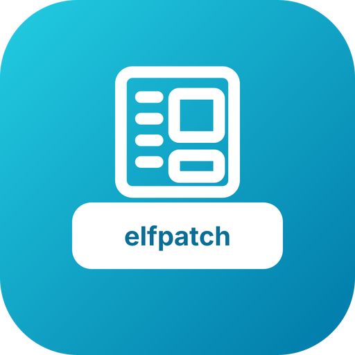

# go-binfmt — brand assets

Official logos for the **go-binfmt** organization.

The mark is an ELF file as its program headers describe it: the header table
down the left, the loadable segments it maps on the right, one tall and one
short. It shares the cyan gradient (`#22CCE2` → `#0079A8`) of the
systems/boot organisations and differs from them by its glyph alone.

## Formats

- **SVG** — `svg/color`, `svg/white` (white, transparent), `svg/black` (black, transparent)
- **PNG** 16→1024 px, 3 variants — `png/<variant>/<size>/`
- **JPG** (color, white background) — `jpg/<size>/`
- **ICO** (Windows) — `ico/`
- **ICNS** (macOS) — `icns/`
- **GitHub avatar** 512 px — `avatar/`
- **Social preview** 1280×640 (repo banner) — `social/`

## Repos (1)

| | repo |
|---|---|
|  | `elfpatch` |

---
*Generated with brandgen (go-gfx/gfx, go-opentype): rounded square badge, line glyph, color / white / black variants.*
